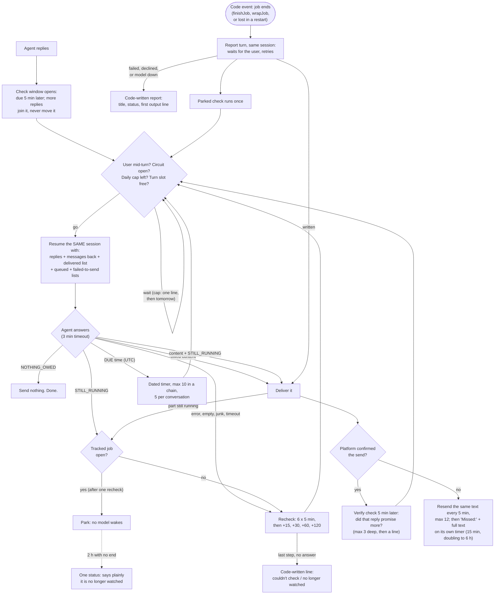

# nothing-owed

**A timer on every agent reply. When it fires, the agent checks its own conversation against what really reached the user, and delivers whatever it still owes. When the check cannot be done, code tells the user in plain words instead of going quiet.**

> **TIRED OF AI AGENTS PROMISING THINGS THEY NEVER DELIVER?**
>
> Your agent swore it would send the report "as soon as it lands"... and it never landed?
> Your assistant said "I'll get back to you" and then simply *ceased to exist between turns*?
>
> **WELL, LESS OFTEN NOW.**

[](./LICENSE)
[](./package.json)
[](https://github.com/muziksociety/nothing-owed/actions/workflows/ci.yml)




**Rule of thumb:** code holds every alarm (check windows, rechecks, dated timers, job-end events, delivery confirmation, turn and callback timeouts, the circuit breaker). The model is only woken to judge and to write. When the model cannot answer, code writes the line the user gets.

## The problem

*(Dramatic black-and-white footage of a person staring at a chat window.)*

LLM agents promise follow-ups they cannot keep, because nothing runs between turns. Claude, GPT, whoever: between your messages, your agent is not "working on it". It is not anything. It is a file on a disk.

Here is how it goes. A user sends a video link. The agent answers: *"Got it, I'll send you the summary when it's done."* It starts the work. The summary does get written, in a background turn whose output never went anywhere. The user waits. Nothing arrives. Ask the agent later and it will often say it already sent it, because the summary is right there in its context.

The agent did not lie. It just has no clock, and it cannot tell "I wrote it" from "the user received it".

### Real* testimonials

> "My agent said 'downloading now, full summary coming.' I'm still waiting."
> **A Real Human**, three weeks later

> "It told me it would 'circle back.' It has not circled. It has not even lined."
> **A Project Manager**, slowly losing faith

> "I asked if it sent the file. It said yes. With confidence. With *bullet points.*"
> **Someone Who Checked Their Inbox**

<sub>*Invented. Any resemblance to your own agent is, sadly, extremely likely.</sub>

## The fix

**How it works: we exploit the one thing your agent is truly reliable at. Forgetting.**

- The first reply the agent sends opens a check window for that conversation, due **5 minutes later**. More replies join the list but never move the due time, so a chatty conversation cannot push a debt back forever. (The check still waits for a user who is mid-turn, an open circuit breaker or a daily cap; see below.)
- When the check runs, resume the **same** session and show the agent what it replied since the last check, and what the host **actually delivered**, from the host's own send log.
- The agent answers `NOTHING_OWED`, `STILL_RUNNING`, `DUE <time>`, or the thing it owes, which goes to the user.

No promise detection, no phrase lists, no extractor model. It relies on the agent forgetting, and on the agent being good at judging its own conversation once it is shown the truth about delivery.

### But wait, there's more!

- **Zero dependencies.** Nothing to install but the thing itself.
- **Survives restarts.** Checks, dated timers, owed reports, retries, missed notices and the delivered log live next to each other in the store. Jobs that died with the old process are reported as lost, not waited on.
- **Polite.** If the user is mid-conversation, checks and job reports wait their turn.
- **Says so when it fails.** A check that keeps failing, a report the model will not write, a last check with nothing to say, a reached cap: each ends with a short code-written line, not with silence. Those lines never claim a promise was made, and a broken model setup does not spam users who were promised nothing: after 5 failed turns in a row a circuit breaker pauses the checks.
- **Reads its own replies back.** A delivered check reply can itself be a new promise ("ten more minutes"). It gets one follow-up check; the chain is capped at 3.
- **Knows about dates.** "I'll remind you tomorrow at 9" becomes a timer in code. Chains of dates are capped too.
- **Knows about long jobs.** Link a job to the conversation in code and the check sleeps until it ends. Then the user gets one report.
- **Keeps failed sends.** A failed send is kept and resent, not regenerated. If it never lands, a `Missed:` notice with the full text keeps trying on its own timer, and you can take it with `flushMissed()`. (The platform still has to be reachable at some point; nothing can deliver to a chat that is gone.)
- **Bounded.** Rechecks, verify chains, DUE chains, dated timers, turns per conversation per day, turns per day overall, turns at once, and every host callback have limits. The tests check each one.

**Operators are standing by.** *(They are a `setTimeout`.)*

<sub>Side effects may include: receiving the things you were promised. Consult your send log before use.</sub>

## Quick start

```sh
npm install nothing-owed
```

```js
import { createNothingOwed, createFileStore } from 'nothing-owed';

// One queue per conversation, used by user turns AND check turns: two turns never run on the
// same session at once.
const queues = new Map();
function inQueue(id, fn) {
  const next = (queues.get(id) ?? Promise.resolve()).then(fn, fn);
  queues.set(id, next.catch(() => {}));
  return next;
}
const busy = new Set(); // conversations with a user turn in progress

const owed = createNothingOwed({
  store: createFileStore('./data/pending-checks.json'), // also keeps the delivered log, and a lock file
  runTurn: (id, prompt, ctx) => inQueue(id, () => agent.resume(id, prompt, { signal: ctx.signal })), // same session
  deliver: (id, text) => chat.send(id, text), // throw if the platform did not confirm
  isUserBusy: (id) => busy.has(id),
  timeZone: 'Europe/Madrid', // optional: the users' local time in the prompt (or (id) => zone)
});
await owed.start();

// your user-turn handler:
async function onUserMessage(id, userText) {
  owed.noteUserMessage(id);                // counts messages, so the check can say "8 messages back"
  busy.add(id);
  try {
    const text = await inQueue(id, () => agent.resume(id, userText));
    for (const line of owed.flushMissed(id)) await chat.send(id, line); // owed "Missed:" notices first
    await chat.send(id, text);
    owed.noteDelivered(id, text);          // it really reached the user
    owed.noteReply(id, text);              // the agent replied: opens (or joins) the check window
  } finally {
    busy.delete(id);
  }
}

// wherever the agent starts long work for a conversation:
const result = await owed.wrapJob('chat-42', 'render-17', renderVideo(), { title: 'render' });
// If you send `result` yourself, the report turn sees it and stays quiet.

// on shutdown:
await owed.stop();                         // writes the final state
```

Two rules for `runTurn`:

- **Serialize it with your user turns.** A check turn resumes the same session as the user's turns. Do not run both at once: put both through one queue per conversation, as above. `isUserBusy` only makes the check wait politely; the queue is what guarantees it. (`onTurnStart` / `onTurnEnd` and `isChecking(id)` are there if you serialize another way.) A check queued behind a long user turn counts toward `turnTimeoutMs`.
- **It must not send anything itself.** It returns the agent's text; the package decides whether it goes to the user and sends it through `deliver()`. If your agent runtime posts its replies to the chat on its own, turn that off for these turns.

What the package sends through `deliver()` it counts and logs as delivered itself. If your send path also calls `noteDelivered` or `noteReply` for those messages, that is fine: the same text within a minute is one entry, and the package recognizes its own deliveries coming back through `noteReply`. `deliver()` gets a third argument, `{ kind, checkId, jobId }`, if you want to tell them apart.

**One process per store.** The file store writes `<path>.lock` with its process id and refuses a second live process. Two processes on one store would overwrite each other's state.

**Keep the process alive.** The scheduler's timers are unref'd: they never keep Node running on their own. In a bot or server, the polling loop or the open port does that; in a script, keep something alive (or the checks never fire).

### Wiring

Three lessons from putting the package into a real Telegram bot that sends rendered media to its users:

- **Run your reply guards inside `deliver()`.** If your host filters or guards its own replies (for example, it blocks false "it's on its way" promises), the package's messages must pass the same guards: they reach the user through `deliver()`, not through your normal reply path. Return `{ text }` when a guard rewrote the text, and `{ skipped: true }` when it blocked it.
- **Package messages are not normal replies.** Everything sent through `deliver()` carries `meta.kind` (`check`, `report`, `giveup`, `fallback` or `missed`). Do not treat these as a normal agent reply that can start actions. For example, if a check message ends with "shall I do it?" and the user answers "yes", that "yes" must not trigger work on its own: route it through a normal user turn, where the agent sees its history and decides.
- **Tell the package when you already told the user.** If your own error handler sends a failure message for a job, pass `userNotified: true`, or the report turn sends a second one:

  ```js
  try {
    await renderVideo(jobId);
    await owed.finishJob(jobId, { status: 'done', text: 'rendered' });
  } catch (err) {
    await chat.send(id, 'Sorry, the render failed. Try again later.');
    await owed.finishJob(jobId, { status: 'error', text: err.message, userNotified: true });
  }

  // with wrapJob: your catch tells the user, so a rejection runs no report turn
  await owed.wrapJob(id, jobId, renderVideo(), { title: 'render', userNotifiedOnError: true })
    .catch(() => chat.send(id, 'Sorry, the render failed. Try again later.'));
  ```

  If you only learn later that the user was told, call `noteJobUserNotified(jobId)`: a report still waiting is skipped, and one already being written is dropped before `deliver()` (event `report_dropped`).

Try it without an API key (a fake model on a virtual clock; every run prints exactly this):

```sh
node examples/simulate.mjs
```

```text
[min   0.0] user   "Can you summarize this video? https://example.com/v/123"
[min   0.0] host   -> user: "Got it. I'll send the summary when it's done."
[min   0.0] timer  check window opened: fires in 5 min, later replies will not move it
[min   1.0] agent  wrote the summary in a background turn... but nothing sent it (dropped)
[min   5.0] check  fires; the agent audits its conversation (its first reply: 1 message back)
[min   5.0] host   -> user: "SUMMARY: three points: setup, demo, pricing. Verdict: worth a watch."
[min   5.0] check  owed item delivered
[min   5.0] timer  verify check in 5 min on what was just delivered
[min   5.5] user   "Now render the full video, please."
[min   5.5] host   -> user: "Starting the render. It takes a while; I will report when it is done."
[min   5.5] job    tracked: render
[min  10.0] check  fires; the agent audits its conversation (its first reply: 3 messages back)
[min  10.0] check  STILL_RUNNING
[min  15.0] check  fires; the agent audits its conversation (its first reply: 3 messages back)
[min  15.0] check  STILL_RUNNING
[min  15.0] check  an open job: parked on render-1, no wakes until it ends
[min  25.5] job    finished: done
[min  25.5] report the job ended; one report turn
[min  25.5] host   -> user: "Render finished: 4 clips, 2.1 GB. Nothing else is open."
[min  25.5] timer  verify check in 5 min on what was just delivered
[min  25.5] check  unparked: runs once now
[min  25.5] check  fires; the agent audits its conversation (its first reply: 4 messages back)
[min  25.5] check  NOTHING_OWED: nothing sent
[min  31.0] done   one dropped promise caught, one long job reported; 5 model wakes in total
```

## How it works

1. **`noteReply(conversationId, text)`** after each reply the agent sends. If that conversation has no pending check, one is created, due `delayMs` (5 minutes) later. If it has one, the reply joins its list and the due time stays put. After a check runs, the next reply opens a new window. A long list keeps reply 1 plus the newest ones; a long reply keeps its first and last 150 characters, because promises like to sit at the end.
   **`noteUserMessage(conversationId)`** for each user message. Together with replies it drives a per-conversation counter, so the prompt can show each reply as `(8 messages back, <time>)` and ask the agent to look the promise up in its own history.
2. **`noteDelivered(conversationId, text)`** whenever your transport confirms a message reached the user (or pass your own `getDelivered`). This is the ground truth. Record it at the transport layer, after the send succeeded, never from what the model says it sent. It never throws into your send path.
3. **When the check is due**, it asks `isUserBusy` and your send log first, without holding a turn slot, then waits for a slot (2 at once, growing by one per 25 waiting turns up to 8), then builds the prompt and calls `runTurn(conversationId, prompt, ctx)`. Every host callback times out after `callbackTimeoutMs` (30 s). The prompt shows the time now (UTC, and the users' local time with `timeZone`), the agent's replies, the newest 40 delivered messages since just before the first reply, anything queued for a retry ("do not write these again"), anything given up on ("write it again if still needed"), and whether the send log reaches back far enough. It says:

   > Only what is in this delivered list reached the user. Anything you wrote that is not in it, they never saw. Never say something was sent unless it is in this list.

4. **The answer is parsed** and acted on (see Outcomes). A turn that throws, comes back empty or as tool-call markup (`isJunk`), or runs past `turnTimeoutMs` (3 minutes; `ctx.signal` is aborted) is a failed check, and failed checks come back on the recheck ladder.
5. **Everything the package delivers gets one verify check** `delayMs` later, so a reply that is itself a promise ("the rest in ten minutes") is watched too. The chain stops after `maxVerifyDepth` (3) with a code-written line. There is no verify after a last-check status or after a delivery that also set a `DUE` timer (the timer is the follow-up). Replies you deliver yourself and note with `{ kind: 'check' }` or `{ kind: 'report' }` get the same single verify.
6. **Everything persists** in the store: checks, dated timers, owed report turns, counters, open jobs, retries, missed notices, caps and the circuit breaker; the built-in delivered log sits next to it. Writes are batched (100 ms); `stop()` writes the final state. `start()` reloads it and merges anything you noted before it finished loading. Stores from v0.1 to v0.3 still load.

The full prompt is in [`src/outcome.js`](./src/outcome.js). Override it with `buildPrompt` if you need to.

## Outcomes

| The agent answers | What happens |
|---|---|
| `NOTHING_OWED` | Nothing is sent. The check ends. |
| `STILL_RUNNING` | The only debt is background work that will report on its own. Nothing is sent. With an open tracked job the check comes back once more `delayMs` later, then parks until the job ends (see Long jobs). Without one it comes back `delayMs` later, `maxRechecks` (6) times, then backs off by `backoffMs` (15, 30, 60, 120 minutes). The final step asks for a one-line status that says plainly the work is no longer watched. |
| text, plus a `STILL_RUNNING` line | Part of the debt is ready, part is still running. The text (minus the marker) goes to the user, and the check comes back for the rest. |
| `DUE <UTC time>`, alone or after text | A promise for a later time. Any text goes out now, except a short status note that opens with "nothing (new/else) owed" and has no link; a dated timer is stored, and at that time a check runs with the replies that made the promise. With `STILL_RUNNING` too, both happen. Times in the past or more than `maxDueMs` (30 days) away count as `STILL_RUNNING`. A chain of `DUE` answers stops after `maxDueDepth` (10), and a conversation holds at most 5 dated timers; past either, a code-written line. |
| anything else | It is the owed content. It goes to the user through `deliver()`, unless it is a word-for-word copy of something queued, given up on, or delivered since this check last ran (or in the last 10 minutes). Dated checks are never compared, so a daily reminder goes out every day. |
| empty, `...`, a `failTexts` entry, tool-call markup, an error, or a timeout | Nothing is sent now; the check comes back on the same ladder. If the last step still fails, the user gets the `giveUpText` line, *"I may have said I'd follow up on something, and I couldn't check it. Ask me if anything is still open."*, at most once per conversation per outage, and never while the circuit breaker is open (then the step waits for it to close). |

If the last check answers only `STILL_RUNNING`, code sends a line too, saying the work may still be running and is no longer watched.

Parsing is strict about what it sends and loose about how markers look:

- Markers count on the first line or among the last two lines, in any case, with quotes, bold, code marks, code fences, punctuation, a `Status:` label or a short note around them: `` `NOTHING_OWED` ``, `**Nothing owed.**`, `STILL_RUNNING (render)`. All marker lines are removed from what is sent.
- `DUE` is upper-case only and needs a date and a time (`T` or a space between them). No zone, `Z`, `UTC` or `GMT` all mean UTC, as the prompt asks; an explicit offset (`+01:00`) is kept. It may sit in `<...>` and carry a short note. Any other `DUE` line counts as `STILL_RUNNING`. "Due 12 May..." in a sentence stays text.
- A last-line `NOTHING_OWED` means nothing is sent (what came before was reasoning). A first-line `NOTHING_OWED` followed by one short plain remark is still nothing; followed by real content (more than one sentence, a link, "except", "but", "however"), or `NOTHING_OWED except ...`, it delivers that content. Brackets and emoji around markers are ignored.
- A reply whose last sentence holds `NOTHING_OWED`, or is a short "nothing is owed" with no numbers in it, is nothing. `NOTHING_OWED` and `STILL_RUNNING` together keep the check open.
- A `STILL_RUNNING` inside a sentence is sent as "still running" and the check stays open. `<think>` blocks are removed. The same parser reads job reports.

## Long jobs

The agent says "the render takes an hour, I'll report when it's done". A timed recheck every five minutes would wake the model twelve times to hear "still running". So don't make the model remember the job: link it in code, where you start it.

```js
owed.trackJob(conversationId, jobId, { title: 'render' });   // when the work starts
owed.finishJob(jobId, { status: 'done', text: output });     // when it ends: 'done' | 'error' | 'stopped'

// or both at once, around any promise:
const output = await owed.wrapJob(conversationId, jobId, renderVideo(), { title: 'render' });
```

- A check that answers `STILL_RUNNING` while the conversation has an open tracked job comes back once more, then **parks** on it. No model wakes while parked. A *failed* check never parks: it takes the ladder, so an unrelated open job cannot delay a promise.
- `finishJob` and `wrapJob` resolve at once. In the background, the package queues **one report turn** in the same session (job title, status, its output, the messages delivered since the job ended, "tell the user what it produced and what is still open"). If you already sent the result yourself and noted it with `noteReply`, the report turn sees it, answers `NOTHING_OWED`, and nothing more is sent. The report is stored, waits while the user is mid-turn, and a failed report turn is retried on the same ladder as a check. It is marked delivered in the store right before it is sent, so a crash after the send never sends it twice. Events tell you when it is done: `report_delivered`, `report_fallback`, `report_done`.
- If the report turn keeps failing, answers `NOTHING_OWED` (with no reply of yours since the job ended) or only `STILL_RUNNING`, or the circuit breaker says the model is down, the user gets a **code-written report**: `<title> <status>: <first line, up to 300 characters>`. For an object result that line is its `text` or `summary`, never raw JSON; without either it is just `<title> <status>.`
- If your host already told the user how the job ended (its own failure message, say), pass `finishJob(jobId, { ..., userNotified: true })` or `wrapJob(..., { userNotifiedOnError: true })`: no report turn runs, a `report_skipped` event fires with reason `user_notified`, and parked checks still unpark. See Wiring.
- Pass `onJobFinished(conversationId, job)` to deliver the result yourself instead. Note what you send with `noteReply(id, text, { kind: 'report' })` so it gets its verify check.
- Then the parked check runs once, in case something else was owed. A check parked on two jobs waits for both.
- **Safety net:** a check parked longer than `jobTimeoutMs` (2 hours) runs once with the last-check prompt, so the user gets a one-line status that says plainly it is no longer watched, parks one more period, then ends.
- **Restarts:** a job in the store at `start()` died with the old process, as far as the package knows. It finishes as `lost` (*"the work was interrupted by a restart"*), which runs the normal report and unparks its checks. If your host really does keep jobs running across restarts, return their ids from `onStartJobs(jobs)`.

## Delivery retry and missed notices

`deliver()` counts as done only when it resolves. **Throw when the platform did not confirm the send** (for example, no message id came back). You may return `{ ids }`; they go into the `delivered` event. If your send path changes the text on the way out (a guard rewrite), return `{ text }` with what was really sent: the delivered log and the verify check use it. If it decides not to send at all, return `{ skipped: true }`: nothing is logged as delivered, there is no verify and no retry, and a `delivery_skipped` event fires. A `deliver()` that does not settle within `callbackTimeoutMs` counts as failed and goes to the outbox; if it later succeeds after all, the user can get that text twice.

A failed delivery is kept in the store and resent every `retryMs` (5 minutes), up to `maxDeliveryAttempts` (12). Retries resend the text already written; they never call `runTurn` again. Checks that run meanwhile see it in the prompt's queued list, and a word-for-word copy is not sent twice. An error with `retryAfterMs` sets the wait for that attempt; `isPermanentError(err)` returning true stops at once.

After a give-up you get a `delivery_failed` event and the full text becomes a **missed notice** with its own timer: 15 minutes later it tries to send `Missed: <full text>`, and while that fails the wait doubles up to 6 hours, until it lands or you take it with `flushMissed(conversationId)` (send those lines before your next normal message). It also goes out before any later package delivery in that conversation, one sender at a time. Checks list it as "failed to send - write it again if still needed". After a permanent error the notice waits for `flushMissed`.

## Caps and the circuit breaker

- **Per conversation:** `dailyCap` (60) model turns per UTC day. The last `dailyCapReserve` (10) are kept for window checks (a new reply) and dated checks. Past the cap, the check waits for the next day and the user gets one line a day: *"I've hit today's limit for checking on promises; I'll check again at 00:00 UTC."* Reports past the cap use the code-written report.
- **Overall:** `globalDailyCap` (1000) model turns per UTC day across all conversations; reaching it emits `global_daily_cap` once, for you.
- **Circuit breaker:** after `circuitFailures` (5) failed turns in a row, across conversations, model turns pause for 15 minutes, then one probe turn runs; each failed probe doubles the pause up to 2 hours. `circuit_open` and `circuit_closed` events tell you. While it is open, give-up lines wait (so a broken setup does not tell every user something went wrong with a promise they never got), and due reports go out as their code-written version.
- **Stuck busy:** if `isUserBusy` stays true for 30 minutes, you get one `busy_stuck` event; the check keeps waiting.

## Configuration

| Option | Default | Meaning |
|---|---|---|
| `runTurn(id, prompt, ctx)` | required | Resume the same conversation's session with `prompt`; return the reply text, or `{ text, usage, costUsd }`. `ctx` has `kind`, `reason`, `isLastCheck` and an abort `signal`. Serialize it with user turns; it must not send anything itself. |
| `deliver(id, text, meta)` | required | Send a package-made text. `meta` is `{ kind, checkId, jobId }`, kind `check`, `report`, `giveup`, `fallback` or `missed`. Throw if the send was not confirmed. |
| `store` | memory | `createFileStore(path)` (keeps the delivered log and a lock file next to it), `createMemoryStore()`, or any `{ load(), save(state) }`. |
| `isUserBusy(id)` | none | `true` while the user is mid-conversation; checks and reports wait `busyRetryMs` and try again. |
| `getDelivered(id, sinceMs)` | built-in log | Your own send log: `[{ at, text }]` for that conversation since `sinceMs`. |
| `timeZone` | UTC only | IANA zone of your users for the "Now:" line, or `(id) => zone`. |
| `delayMs` | `300000` (5 min) | The check is due this long after the first reply of a window. Also the recheck and verify delay. |
| `onJobFinished(id, job)` | report turn | Deliver a finished job's result yourself instead of the report turn. |
| `onStartJobs(jobs)` | keep none | Jobs found in the store at `start()`: return the ids your host still runs; the rest finish as `lost`. |
| `giveUpText(ctx)` | built-in lines | The code-written lines; `ctx.reason` is `failed`, `still_running`, `verify_capped`, `daily_cap` (with `until`) or `due_limit`. |
| `strings` | English (`defaultStrings`) | Replace any user-visible string: `missedPrefix`, `fallbackReport` / `fallbackReportNoLine` templates (`{title}`, `{status}`, `{line}`), `status` words, `lostText`, and the `giveUp` lines (`daily_cap` fills `{time}`). A partial set keeps the other defaults; `giveUpText` still wins for the give-up lines. |
| `promptLanguage` | none | For example `'Spanish'`: the check and report prompts add "Write anything for the user in Spanish." The rest of the prompt stays English. |
| `dailyCap` | `60` | Model turns per conversation per UTC day (`0` disables). |
| `onEvent(event)`, `onUsage(info)` | none | Every event (see `index.d.ts`), and turn usage or cost. |

<details>
<summary>Advanced options</summary>

| Option | Default | Meaning |
|---|---|---|
| `onTurnStart(id, ctx)`, `onTurnEnd(id, ctx)` | none | Called around every model turn, if you serialize turns another way than one queue. |
| `maxRechecks` | `6` | Timed rechecks at `delayMs` after `STILL_RUNNING` or a failed turn. |
| `backoffMs` | `[15, 30, 60, 120]` min | Further recheck steps after those; the last asks for a one-line status. `[]` disables. |
| `turnTimeoutMs` | `180000` (3 min) | A turn that does not settle by then counts as failed; `ctx.signal` is aborted. `0` disables. |
| `callbackTimeoutMs` | `30000` | Timeout for `deliver`, `isUserBusy`, `getDelivered`, `onJobFinished`, `onStartJobs` and the turn hooks. `0` disables. |
| `isJunk(text)` | tool-call markup | A reply it flags is a failed check, never delivered. The default catches lines starting with `<｜`, and `invoke name=`, `<tool_call`, `<function_calls>`. |
| `maxVerifyDepth` | `3` | Verify checks in a row (a normal reply starts a new chain). |
| `maxDueMs`, `maxDueDepth`, `maxDatedPerConversation` | 30 days, `10`, `5` | Limits for `DUE`. |
| `maxConcurrent`, `maxConcurrentLimit` | `2`, `8` | Model turns at once; one more per 25 waiting, up to the limit. |
| `dailyCapReserve`, `globalDailyCap` | `10`, `1000` | Turns of `dailyCap` kept for window and dated checks; turns per day overall (`0` disables). |
| `circuitFailures`, `circuitPauseMs`, `circuitMaxPauseMs` | `5`, 15 min, 2 h | The circuit breaker. `circuitFailures: 0` disables it. |
| `jobTimeoutMs` | `7200000` (2 h) | A check parked on jobs this long gets one status check, then one more period, then ends. |
| `retryMs`, `maxDeliveryAttempts` | 5 min, `12` | Delivery retries. |
| `missedRetryMs`, `missedMaxRetryMs` | 15 min, 6 h | The missed-notice timer. |
| `isPermanentError(err)` | never | `true` stops retrying at once. |
| `busyRetryMs`, `busyStuckMs` | 1 min, 30 min | Busy retry, and when to emit `busy_stuck`. |
| `deliveredLookbackMs` | `600000` | The delivered window opens this long before the first reply (a streamed reply can land before its turn ends). |
| `maxReplies`, `maxTextLength`, `maxDeliveredInPrompt`, `maxReportLength` | `12`, `300`, `40`, `1500` | Prompt bounds. |
| `saveDebounceMs`, `idlePruneMs` | 100 ms, 30 days | Batched writes; counters of conversations idle this long are dropped. |
| `userLabel`, `failTexts` | `"the user"`, `[]` | How the prompt names the user; canned error notices treated as failures. |
| `buildPrompt`, `buildReportPrompt`, `parseOutcome` | built-in | Replace the prompts or the parser. |
| `deliveredLog` | with the store | `createDeliveredLog({ path })` to keep it elsewhere. |
| `now`, `setTimer`, `clearTimer` | real clock | Inject for tests. |

</details>

Methods: `noteReply(id, text, { kind? })`, `noteUserMessage(id)`, `messageCount(id)`, `noteDelivered(id, text, at | { at, id })`, `flushMissed(id)`, `isChecking(id)`, `trackJob(id, jobId, { title })`, `finishJob(jobId, { status, text, summary, userNotified })`, `wrapJob(id, jobId, promiseOrFn, { title, userNotifiedOnError })`, `noteJobUserNotified(jobId)`, `start()`, `stop()`, `flush()`, `tick()`, `idle()`, `pending()`, `parked()`, `dated()`, `jobs()`, `reports()`, `outbox()`, `missed()`, `circuit()`.

`noteReply` kinds: none or `reply` opens or joins a window; `check` and `report` (replies you delivered yourself) count and get one verify check; `giveup`, `fallback` and `missed` only count; `system` does neither.

Also exported: `buildPrompt()`, `buildReportPrompt()`, `parseOutcome()`, `parseCheckReply()`, `stripStillRunning()`, `clipText()`, `isJunkReply()`, `defaultGiveUpText(ctx, strings?)`, `fallbackReportText(job, strings?)`, `defaultStrings`, `createFileStore()`, `createMemoryStore()`, `createDeliveredLog()`, `NOTHING_OWED`, `STILL_RUNNING`. Types are in [`index.d.ts`](./index.d.ts).

## Adapters

| Example | What it shows |
|---|---|
| [`examples/simulate.mjs`](./examples/simulate.mjs) | A dropped promise caught by a fake model. No API key. |
| [`examples/telegram-grammy`](./examples/telegram-grammy) | A grammY API transformer that logs every successful Bot API send (and edits of streamed messages, and captionless media as `[photo]`, `[document]`...) as delivered. One conversation per chat and forum topic. |
| [`examples/claude-agent-sdk`](./examples/claude-agent-sdk) | The check turn resumes the conversation's session by id with `query({ options: { resume } })`. |
| [`examples/claude-code-cli`](./examples/claude-code-cli) | The check turn is `claude -p --resume <session id> --output-format json`, with per-check cost from the token counts. |

## Results

**Small replay: 9 past conversations, one model, v0.1 prompt.** A later replay of the v0.3 prompt on 18 cases, 3 runs each, scored 49/54 runs correct with Claude and 41/54 with DeepSeek; the misses it found (marker combinations, tool-call markup sent as text, time zones, claims about files) are handled in v0.4's parser and prompt. The v0.4.1 prompt was then replayed with Claude on the 14 real cases, 2 runs each: 23/28 correct, **0 false alarms**, 2 misses (a running build answered as `NOTHING_OWED` once each), every combined `STILL_RUNNING` + `DUE` answer now parsed correctly, and one local-time reminder set 1.5 hours early twice. Cost: about $0.54 per check on a cold prompt cache, $0.01 to $0.03 warm. A cheap model (DeepSeek, `deepseek-flash`) on the same prompt, 18 cases, 2 runs each: 28/36 correct, about $0.0003 per check, 1 miss, 4 false alarms. All 4 false alarms said an image "never arrived"; in that replay the delivered list held no photo entries (the old send log did not record media), so they are most likely a gap in the test data, not in the model. It also once returned tool-call markup (caught by `isJunkReply`) and twice wrote a status sentence before a `DUE` line, which v0.4.2 no longer sends. Small samples: treat these as a smoke test, not a benchmark. Everything else v0.4 adds is covered by tests on a fake clock with a fake model.

| Test (v0.1 prompt, offline replay, tools sealed off) | Result |
|---|---|
| Owed cases caught | **4 / 4** (one of them as `STILL_RUNNING`) |
| False alarms on conversations where nothing was owed | **0 / 5** |
| Earlier prompt version, without the delivered list | 3 / 4 caught |
| Cost per check in the replay, cold cache | about **$0.53** |
| First live check, cold cache | **$0.36** |
| First live check, warm cache (it delivered a 763-character reply) | **$0.035** |
| Daily cost with the fixed window and verify checks | not measured |

The delivered list is what closed the gap from 3/4 to 4/4: without it, the agent sees a summary in its own context and assumes the user got it.

**Cost and the prompt cache.** The check turn re-reads the whole session, so prompt caching decides the price: in the table, a warm-cache check cost about a tenth of a cold one ($0.035 against $0.36). Many providers keep a prompt cache for about 5 minutes, and the default `delayMs` is also 5 minutes, so a check can land just after the cache expired and pay the cold price. If your provider offers a longer cache lifetime, or you can shorten `delayMs` a little below it, checks get much cheaper. Report `usage` from `runTurn` and track it with `onUsage`.

## How it compares

- **Commitment tracking (extractor model plus a ledger).** A second model reads each reply, extracts promises into a ledger, and a scheduler chases open items. It works, but it adds a model call per reply, an extraction schema, and a classifier that can miss promises phrased in a way it did not expect. nothing-owed has no extractor: every reply gets the same blind timer, and the agent that made the promise judges it, with its full context.
- **Durable workflow engines (Temporal, Inngest, and similar).** Great when the follow-up is a known step in code: they guarantee that step runs. They do not know about promises the model improvised in free text. You can run nothing-owed on top of one, using it as the timer and store.
- **Why a blind timer plus self-audit is simpler.** One timer per conversation, one extra turn per 5-minute window, no promise detection. The hard part, "is anything still owed?", goes to the party best placed to answer it, and the delivered list gives it the one fact it cannot know on its own.

## FAQ

**What does it cost?** One extra turn per conversation per 5-minute window, not per message, plus one verify turn after each message the package delivers. Most checks answer `NOTHING_OWED` with a few output tokens; the input is the resumed session, so the prompt cache matters most (see the cost note above). `dailyCap`, `globalDailyCap` and the circuit breaker bound the worst case.

Honest note: v0.1 waited for the conversation to go quiet, and that was cheaper: a long chat cost one check. Since v0.2 the check is due 5 minutes after the first reply even mid-conversation, so a 30-minute chat costs about six checks. That is on purpose: waiting for silence let a busy conversation push a promise back forever. Failed checks come back instead of being dropped, which costs more turns during an outage (the circuit breaker limits that). Long jobs, at least, are cheap: a parked check costs nothing until the job ends.

**What about false alarms?** In the replay above, 0 of 5 conversations where nothing was owed produced a message. The parser accepts the usual near misses of `NOTHING_OWED`, and treats tool-call markup as a failure. A long reply without a marker is still delivered, so a model that rambles will send a message. If you see that, add an example to your system prompt or tighten `buildPrompt`.

**Why not detect promises with phrases?** Promises come in every language and phrasing ("I'll ping you", "te aviso", "will report back", "give me ten minutes"), and many debts are implied rather than promised. A phrase list misses those and fires on harmless ones. The agent already knows what it meant.

**Can it loop?** Every chain has a cap, and the tests drive each one to its end on a fake clock: rechecks (`maxRechecks` plus the back-off steps), verify checks (`maxVerifyDepth`), `DUE` chains (`maxDueDepth`, 5 timers per conversation), parked checks (`jobTimeoutMs` plus one period), delivery retries (`maxDeliveryAttempts`), missed notices (doubling to 6 hours), and turns per conversation and overall per day. A word-for-word repeat of something just sent is not sent again.

**What if the user is talking to the agent when the check fires?** Pass `isUserBusy`: checks and report turns wait and retry, and a reply sent meanwhile joins the check. For a hard guarantee, run user turns and `runTurn` through one queue per conversation, as in the quick start.

**Does the agent need tools during the check?** Not to judge. If it owes a result it can only produce with tools, let `runTurn` allow them, but keep the turn short: the prompt tells it not to sleep or poll, `turnTimeoutMs` ends it after 3 minutes, and it cannot send files from this turn (the prompt says so).

## License

[MIT](./LICENSE)

---

<sub>Not affiliated with Anthropic, OpenAI or any agent that owes you something.</sub>
