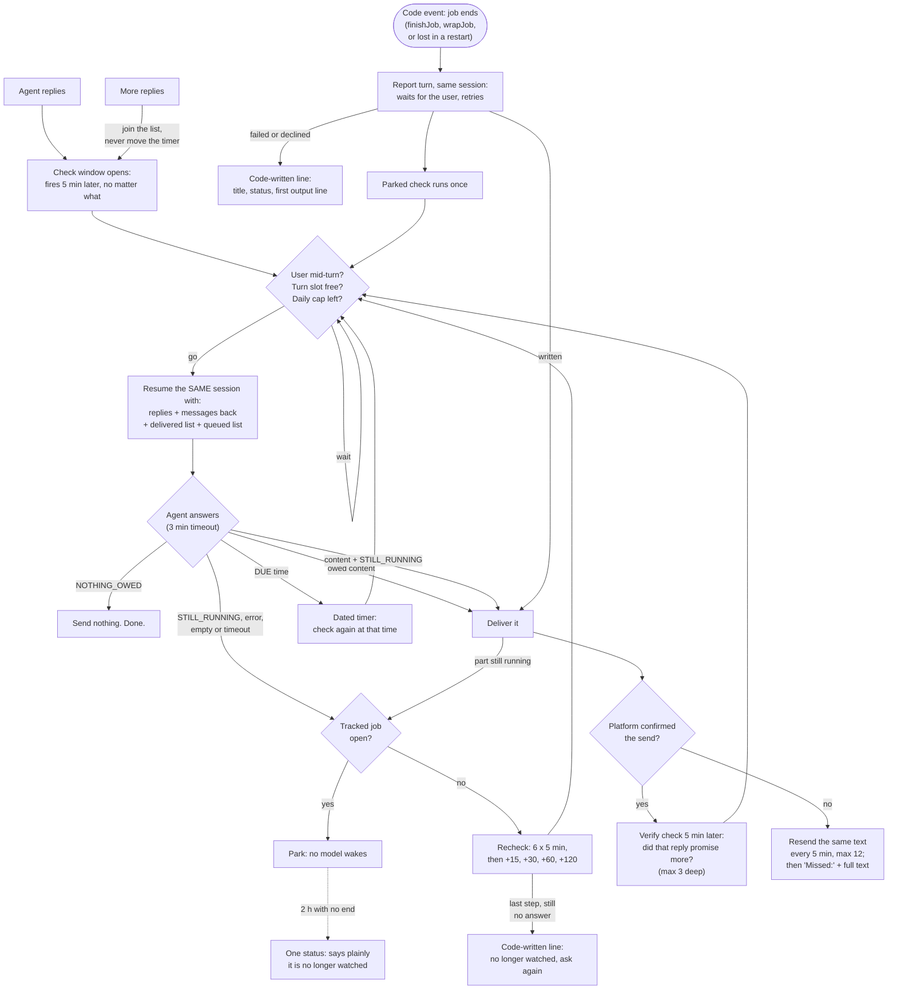

# nothing-owed

**A timer on every agent reply. When it fires, the agent checks its own conversation against what really reached the user, and delivers whatever it still owes. If it cannot, the user is told so, plainly.**

> **TIRED OF AI AGENTS PROMISING THINGS THEY NEVER DELIVER?**
>
> Your agent swore it would send the report "as soon as it lands"... and it never landed?
> Your assistant said "I'll get back to you" and then simply *ceased to exist between turns*?
>
> **WELL, NOT ANYMORE.**

[](./LICENSE)
[](./package.json)
[](https://github.com/muziksociety/nothing-owed/actions/workflows/ci.yml)




**Rule of thumb:** code holds every alarm (check windows, rechecks, dated timers, job-end events, delivery confirmation, turn timeouts). The model is only woken to judge and to write. When the model cannot answer, code writes the line the user gets.

## The problem

*(Dramatic black-and-white footage of a person staring at a chat window.)*

LLM agents promise follow-ups they cannot keep, because nothing runs between turns. Claude, GPT, whoever: between your messages, your agent is not "working on it". It is not anything. It is a file on a disk.

Here is how it goes. A user sends a video link. The agent answers: *"Got it, I'll send you the summary when it's done."* It starts the work. The summary does get written, in a background turn whose output never went anywhere. The user waits. Nothing arrives. Ask the agent later and it will often say it already sent it, because the summary is right there in its context.

The agent did not lie. It just has no clock, and it cannot tell "I wrote it" from "the user received it".

### Real* testimonials

> "My agent said 'downloading now, full summary coming.' I'm still waiting."
> **A Real Human**, three weeks later

> "It told me it would 'circle back.' It has not circled. It has not even lined."
> **A Project Manager**, slowly losing faith

> "I asked if it sent the file. It said yes. With confidence. With *bullet points.*"
> **Someone Who Checked Their Inbox**

<sub>*Invented. Any resemblance to your own agent is, sadly, extremely likely.</sub>

## The fix

**How it works: we exploit the one thing your agent is truly reliable at. Forgetting.**

- The first reply the agent sends opens a check window for that conversation: the check fires **5 minutes later, no matter what**.
- More replies join the list but never move the timer. A chatty conversation cannot push a debt back forever.
- When the check fires, resume the **same** session and show the agent what it replied since the last check, and what the host **actually delivered**, from the host's own send log.
- The agent answers `NOTHING_OWED`, `STILL_RUNNING`, `DUE <time>`, or the thing it owes, which goes to the user.

No promise detection, no phrase lists, no extractor model. It relies on the agent forgetting, and on the agent being good at judging its own conversation once it is shown the truth about delivery.

### But wait, there's more!

- **Zero dependencies.** Nothing to install but the thing itself.
- **Survives restarts.** Checks, dated timers, owed reports and retries live in a file. Jobs that died with the old process are reported as lost, not waited on forever.
- **Polite.** If the user is mid-conversation, checks and job reports wait their turn.
- **Never silent.** A check that keeps failing, a report the model will not write, a last check with nothing to say: each ends with a short code-written line to the user, not with nothing.
- **Reads its own replies back.** A delivered check reply can itself be a new promise ("ten more minutes"). It gets one follow-up check, and the chain is capped.
- **Knows about dates.** "I'll remind you tomorrow at 9" becomes a timer in code, not a hope.
- **Knows about long jobs.** Link a job to the conversation in code and the check sleeps until it ends. Then the user gets one report. No polling, no "still working!" every five minutes.
- **Keeps failed sends.** A failed send is kept and resent, not regenerated. If it never lands, the next message carries `Missed:` and the full text. (The platform still has to be reachable at some point; nothing can deliver to a chat that is gone.)
- **Knows when to stop.** Capped rechecks, a capped verify chain, a per-conversation daily cap, at most two model turns at once.

**Operators are standing by.** *(They are a `setTimeout`.)*

<sub>Side effects may include: receiving the things you were promised. Consult your send log before use.</sub>

## Quick start

```sh
npm install nothing-owed
```

```js
import { createNothingOwed, createFileStore, createDeliveredLog } from 'nothing-owed';

const owed = createNothingOwed({
  store: createFileStore('./data/pending-checks.json'),
  deliveredLog: createDeliveredLog({ path: './data/delivered.json' }),
  runTurn: (conversationId, prompt, ctx) => agent.resume(conversationId, prompt, { signal: ctx.signal }), // same session
  deliver: (conversationId, text) => chat.send(conversationId, text), // throw if the platform did not confirm
  isUserBusy: (conversationId) => turnsInFlight.has(conversationId),
});
await owed.start();

// wherever the user writes to the agent:
owed.noteUserMessage('chat-42');       // counts messages, so the check can say "8 messages back"

// wherever your host sends the agent's reply to the user:
for (const line of owed.flushMissed('chat-42')) await chat.send('chat-42', line); // owed "Missed:" notices first
owed.noteDelivered('chat-42', text);   // it really reached the user
owed.noteReply('chat-42', text);       // the agent replied: opens (or joins) the check window

// wherever the agent starts long work for that conversation:
const result = await owed.wrapJob('chat-42', 'render-17', renderVideo(), { title: 'render' });
```

What the package sends through `deliver()` it counts and logs as delivered itself. If your send path also calls `noteDelivered` or `noteReply` for those messages, that is fine: the same text within a minute is one entry, and the package recognizes its own deliveries coming back through `noteReply`. `deliver()` gets a third argument, `{ kind, checkId, jobId }`, if you want to tell them apart.

Try it without an API key:

```sh
node examples/simulate.mjs
```

```text
[min   0.0] user   "Can you summarize this video? https://example.com/v/123"
[min   0.0] host   -> user: "Got it. I'll send the summary when it's done."
[min   0.0] timer  check window opened: fires in 5 min, later replies will not move it
[min   1.0] agent  wrote the summary in a background turn... but nothing sent it (dropped)
[min   5.1] check  fires; the agent audits its conversation (its first reply: 1 message back)
[min   5.1] host   -> user: "SUMMARY: three points: setup, demo, pricing. Verdict: worth a watch."
[min   5.1] check  owed item delivered
[min   5.1] timer  verify check in 5 min on what was just delivered
[min   5.5] user   "Now render the full video, please."
[min   5.5] host   -> user: "Starting the render. It takes a while; I will report when it is done."
[min   5.6] job    tracked: render
[min  10.2] check  fires; the agent audits its conversation (its first reply: 3 messages back)
[min  10.2] check  STILL_RUNNING with an open job: parked on render-1, no wakes until it ends
[min  25.6] job    finished: done
[min  25.6] report the job ended; one report turn
[min  25.6] host   -> user: "Render finished: 4 clips, 2.1 GB. Nothing else is open."
[min  25.6] timer  verify check in 5 min on what was just delivered
[min  25.6] check  unparked: runs once now
[min  25.6] check  verify check fires: reads back what it delivered (its first reply: 4 messages back)
[min  25.6] check  NOTHING_OWED: nothing sent
[min  31.1] done   one dropped promise caught, one long job reported; 4 model wakes in total
```

## How it works

1. **`noteReply(conversationId, text)`** after each reply the agent sends. If that conversation has no pending check, one is created, due `delayMs` (5 minutes) later. If it has one, the reply joins its list and the due time stays put. After a check runs, the next reply opens a new window. A long list keeps reply 1 plus the newest ones, so the promise that started it all never falls off. A long reply keeps its first and last 150 characters, because promises like to sit at the end.
   **`noteUserMessage(conversationId)`** for each user message. Together with replies it drives a per-conversation counter, so the prompt can show each reply as `(8 messages back, <time>)` and ask the agent to look the promise up in its own history.
2. **`noteDelivered(conversationId, text)`** whenever your transport confirms a message reached the user (or pass your own `getDelivered`). This is the ground truth. Record it at the transport layer, after the send succeeded, never from what the model says it sent.
3. **When the check is due**, it waits for a free turn slot (`maxConcurrent`, 2) and yields if `isUserBusy(conversationId)` is true. Then it builds the prompt, right before the turn, and calls `runTurn(conversationId, prompt, ctx)`, which must resume the same session. The prompt shows the time now, the agent's replies, the newest 40 delivered messages since just before the first reply, and anything queued for a retry ("do not write these again"). It says:

   > Only what is in this delivered list reached the user. Anything you wrote that is not in it, they never saw.

4. **The answer is parsed** and acted on (see Outcomes). A turn that throws, comes back empty, or runs past `turnTimeoutMs` (3 minutes; `ctx.signal` is aborted) is a failed check, and failed checks come back like `STILL_RUNNING` ones.
5. **Everything the package delivers gets one verify check** `delayMs` later: the delivered text joins the next check's list, so a reply that is itself a promise ("the rest in ten minutes") is watched too. The chain stops after `maxVerifyDepth` (3) and never follows a last-check status line. Replies you deliver yourself and note with `{ kind: 'check' }` or `{ kind: 'report' }` get the same single verify.
6. **Everything persists** in the store: pending, parked and dated checks, owed report turns, message counters, open jobs, retries, missed notices. After a restart, `start()` reloads them; a check that was running when the process stopped runs again. Stores from v0.1 and v0.2 still load.

The full prompt is in [`src/outcome.js`](./src/outcome.js). Override it with `buildPrompt` if you need to.

## Outcomes

| The agent answers | What happens |
|---|---|
| `NOTHING_OWED` | Nothing is sent. The check ends. |
| `STILL_RUNNING` | The only debt is background work that will report on its own. Nothing is sent. With an open tracked job the check parks until the job ends (see Long jobs). Without one it comes back `delayMs` later, `maxRechecks` (6) times, then backs off by `backoffMs` (15, 30, 60, 120 minutes). The final step asks for a one-line status that says plainly the work is no longer watched, and ends. |
| text, plus a `STILL_RUNNING` first or last line | Part of the debt is ready, part is still running. The text (minus that line) goes to the user, and the same check comes back later (or parks) for the rest. |
| `DUE <ISO 8601 time>`, alone or as the last line after text | A promise for a later time. Any text goes out now; a dated timer is stored, and at that time a check runs with the replies that made the promise. Times in the past or more than `maxDueMs` (30 days) away count as `STILL_RUNNING`. |
| anything else | It is the owed content. It goes to the user through `deliver()`, unless it is a word-for-word copy of something already delivered or queued. |
| empty, `...`, a `failTexts` entry, an error, or a timeout | Nothing is sent now; the check comes back on the same ladder. If the last step still fails, the user gets the fixed `giveUpText` line: *"I could not check on what I promised you earlier. Ask me again if it is still open."* |

If the last check answers only `STILL_RUNNING`, code sends a fixed line too, saying the work is no longer being watched.

Parsing is strict about what it sends and loose about how markers look. A marker counts as the first or the last line, in any case, with quotes, bold, code marks or punctuation around it, and with a short note after it: `` `NOTHING_OWED` ``, `**Nothing owed.**`, `STILL_RUNNING (render)`. A reply under 200 characters that mentions `NOTHING_OWED` anywhere is never sent: `NOTHING_OWED - all delivered` is nothing. The same parser reads job reports.

## Long jobs

The agent says "the render takes an hour, I'll report when it's done". A timed recheck every five minutes would wake the model twelve times to hear "still running". So don't make the model remember the job: link it in code, where you start it.

```js
owed.trackJob(conversationId, jobId, { title: 'render' });         // when the work starts
await owed.finishJob(jobId, { status: 'done', text: output });     // when it ends: 'done' | 'error' | 'stopped'

// or both at once, around any promise:
const output = await owed.wrapJob(conversationId, jobId, renderVideo(), { title: 'render' });
```

- A check that answers `STILL_RUNNING` (or fails) while the conversation has an open tracked job **parks** on it. No model wakes while parked.
- When the job ends, the package queues **one report turn** in the same session (job title, status, its output, "tell the user what it produced and what is still open"). The report is stored, so a restart does not lose it. It waits while the user is mid-turn, and a failed report turn is retried on the same ladder as a check.
- If the report turn keeps failing, or answers `NOTHING_OWED` or only `STILL_RUNNING`, the user gets a **code-written report**: `<title> <status>: <first line of the output, up to 300 characters>`.
- Pass `onJobFinished(conversationId, job)` to deliver the result yourself instead. Note what you send with `noteReply(id, text, { kind: 'report' })` so it gets its verify check.
- Then the parked check runs once, in case something else was owed. A check parked on two jobs waits for both.
- **Safety net:** a check parked longer than `jobTimeoutMs` (2 hours) runs once with the last-check prompt, so the user gets a one-line status that says plainly it is no longer watched, parks one more period, then ends.
- **Restarts:** a job in the store at `start()` died with the old process, as far as the package knows. It finishes as `lost` (*"the work was interrupted by a restart"*), which runs the normal report and unparks its checks. If your host really does keep jobs running across restarts, return their ids from `onStartJobs(jobs)`.

## Delivery retry

`deliver()` counts as done only when it resolves. **Throw when the platform did not confirm the send** (for example, no message id came back). You may return `{ ids }`; they go into the `delivered` event.

A failed delivery is kept in the store and resent every `retryMs` (5 minutes), up to `maxDeliveryAttempts` (12). The attempt count survives a restart. Retries resend the text already written; they never call `runTurn` again. Checks that run meanwhile see it in the prompt's queued list, and a word-for-word copy is not sent twice. An error with `retryAfterMs` sets the wait for that attempt; `isPermanentError(err)` returning true stops at once.

After a give-up you get a `delivery_failed` event, the full text is kept as a `Missed:` notice, and a fresh check is scheduled `delayMs` later. That check sends the notice first, then judges what is still owed. The notice also goes out before any later package delivery, and `flushMissed(conversationId)` hands it to your host so it can go out before your next normal message. After a permanent error no fresh check is scheduled; the notice waits for `flushMissed`.

## Configuration

| Option | Default | Meaning |
|---|---|---|
| `runTurn(id, prompt, ctx)` | required | Resume the same conversation's session with `prompt`. Return the reply text, or `{ text, usage, costUsd }`. `ctx` has `kind`, `reason`, `isLastCheck` and an abort `signal`. |
| `deliver(id, text, meta)` | required | Send a package-made text to the user. `meta` is `{ kind, checkId, jobId }`, kind `check`, `report`, `giveup`, `fallback` or `missed`. Throw if the send was not confirmed. |
| `getDelivered(id, sinceMs)` | built-in log | Your send log: `[{ at, text }]` for that conversation since `sinceMs`. |
| `isUserBusy(id)` | none | Return `true` while the user is mid-conversation; checks and reports wait `busyRetryMs` and try again. |
| `store` | memory | `createFileStore(path)`, `createMemoryStore()`, or any `{ load(), save(state) }`. |
| `delayMs` | `300000` (5 min) | The check fires this long after the first reply of a window. Also the recheck and verify delay. |
| `maxRechecks` | `6` | Timed rechecks at `delayMs` after `STILL_RUNNING` or a failed turn. |
| `backoffMs` | `[15, 30, 60, 120]` min | Further recheck steps after those; the last asks for a one-line status and ends. `[]` disables. |
| `giveUpText(ctx)` | fixed line | The line sent when the ladder ends with no answer. `ctx.reason` is `failed` or `still_running`. |
| `turnTimeoutMs` | `180000` (3 min) | A turn that does not settle by then counts as failed; `ctx.signal` is aborted. `0` disables. |
| `maxVerifyDepth` | `3` | How many verify checks can follow each other. |
| `maxDueMs` | 30 days | A `DUE` time further away counts as `STILL_RUNNING`. |
| `maxConcurrent` | `2` | Model turns running at once, across all conversations. |
| `dailyCap` | `60` | Model turns per conversation per UTC day. Past it, checks wait for the next day and reports use the code-written line (`daily_cap` event). `0` disables. |
| `jobTimeoutMs` | `7200000` (2 h) | A check parked on jobs this long gets one status check, then one more period, then ends. |
| `onJobFinished(id, job)` | report turn | Deliver a finished job's result yourself instead of the built-in report turn. |
| `onStartJobs(jobs)` | keep none | Jobs found in the store at `start()`: return the ids your host still runs. The rest finish as `lost`. |
| `retryMs` | `300000` (5 min) | Wait between delivery retries. |
| `maxDeliveryAttempts` | `12` | Attempts before giving up on a delivery. |
| `isPermanentError(err)` | never | Return `true` to stop retrying at once. |
| `busyRetryMs` | `60000` | Retry delay while the user is busy. |
| `deliveredLookbackMs` | `600000` | The delivered window opens this long before the first merged reply (a streamed reply can land before its turn ends). |
| `maxReplies` | `12` | A check keeps reply 1 plus the newest N-1 replies. |
| `maxTextLength` | `300` | Longer texts in the prompt keep their first and last 150 characters. |
| `maxDeliveredInPrompt` | `40` | The prompt shows the newest N delivered messages and says how many older ones it left out. |
| `maxReportLength` | `1500` | A job's output is bounded to this length (head and tail) in the report prompt. |
| `userLabel` | `"the user"` | How the prompt names the user. |
| `failTexts` | `[]` | Canned error notices your runtime returns in place of a reply; treated as failures. |
| `onEvent(event)` | none | Every event: `scheduled`, `merged`, `verify_scheduled`, `verify_capped`, `dated`, `check_started`, `yielded`, `daily_cap`, `turn_timeout`, `nothing_owed`, `still_running`, `delivered`, `duplicate_skipped`, `failed`, `gave_up`, `parked`, `unparked`, `park_timeout`, `park_ended`, `job_tracked`, `job_finished`, `job_lost`, `report_delivered`, `report_retry`, `report_fallback`, `delivery_retry`, `delivery_recovered`, `delivery_failed`, `missed_notice`, `usage`, `error`, `started`, `stopped`. |
| `onUsage({ id, usage, costUsd })` | none | Fires when `runTurn` returns usage or cost. Use it to track what checks cost. |
| `buildPrompt`, `buildReportPrompt`, `parseOutcome` | built-in | Replace the check prompt, the report prompt or the parser. |
| `deliveredLog` | memory | `createDeliveredLog({ path })` to persist the built-in log. It drops conversations idle longer than its `maxAgeMs` (2 days). |
| `now`, `setTimer`, `clearTimer` | real clock | Inject for tests. |

Methods: `noteReply(id, text, { kind? })`, `noteUserMessage(id)`, `messageCount(id)`, `noteDelivered(id, text, at | { at, id })`, `flushMissed(id)`, `trackJob(id, jobId, { title })`, `finishJob(jobId, { status, text })`, `wrapJob(id, jobId, promiseOrFn, { title })`, `start()`, `stop()`, `tick()` (run due work now), `idle()` (wait for running work), `pending()`, `parked()`, `dated()`, `jobs()`, `reports()`, `outbox()`.

`noteReply` kinds: none or `reply` opens or joins a window; `check` and `report` (replies you delivered yourself) count and get one verify check; `giveup`, `fallback` and `missed` only count; `system` does neither.

Also exported: `buildPrompt()`, `buildReportPrompt()`, `parseOutcome()`, `parseCheckReply()`, `stripStillRunning()`, `clipText()`, `defaultGiveUpText()`, `fallbackReportText()`, `createFileStore()`, `createMemoryStore()`, `createDeliveredLog()`, `NOTHING_OWED`, `STILL_RUNNING`. Types are in [`index.d.ts`](./index.d.ts).

## Adapters

| Example | What it shows |
|---|---|
| [`examples/simulate.mjs`](./examples/simulate.mjs) | A dropped promise caught by a fake model. No API key. |
| [`examples/telegram-grammy`](./examples/telegram-grammy) | A grammY API transformer that logs every successful Bot API send (and edits of streamed messages) as delivered. One conversation per chat and forum topic. |
| [`examples/claude-agent-sdk`](./examples/claude-agent-sdk) | The check turn resumes the conversation's session by id with `query({ options: { resume } })`. |
| [`examples/claude-code-cli`](./examples/claude-code-cli) | The check turn is `claude -p --resume <session id> --output-format json`, with per-check cost from the token counts. |

## Results

**Small replay: 9 past conversations, one model, v0.1 prompt. The v0.3 prompt (verify checks, `DUE`, the queued list, the new last-check wording) has not been replayed on a real model yet.** Everything v0.3 adds on the code side is covered by tests on a fake clock with a fake model; whether a given model follows the new prompt lines is not measured.

| Test (v0.1 prompt, offline replay, tools sealed off) | Result |
|---|---|
| Owed cases caught | **4 / 4** (one of them as `STILL_RUNNING`) |
| False alarms on conversations where nothing was owed | **0 / 5** |
| Earlier prompt version, without the delivered list | 3 / 4 caught |
| Cost per check in the replay, cold cache | about **$0.53** |
| First live check, cold cache | **$0.36** |
| First live check, warm cache (it delivered a 763-character reply) | **$0.035** |
| Daily cost with the fixed window and verify checks | not measured |

The delivered list is what closed the gap from 3/4 to 4/4: without it, the agent sees a summary in its own context and assumes the user got it.

Cost depends on your model and conversation length; the check turn re-reads the session, so prompt caching matters most. Report `usage` from `runTurn` and track it with `onUsage`.

## How it compares

- **Commitment tracking (extractor model plus a ledger).** A second model reads each reply, extracts promises into a ledger, and a scheduler chases open items. It works, but it adds a model call per reply, an extraction schema, and a classifier that can miss promises phrased in a way it did not expect. nothing-owed has no extractor: every reply gets the same blind timer, and the agent that made the promise judges it, with its full context.
- **Durable workflow engines (Temporal, Inngest, and similar).** Great when the follow-up is a known step in code: they guarantee that step runs. They do not know about promises the model improvised in free text. You can run nothing-owed on top of one, using it as the timer and store.
- **Why a blind timer plus self-audit is simpler.** One timer per conversation, one extra turn per 5-minute window, no promise detection. The hard part, "is anything still owed?", goes to the party best placed to answer it, and the delivered list gives it the one fact it cannot know on its own.

## FAQ

**What does it cost?** One extra turn per conversation per 5-minute window, not per message, plus one verify turn after each message the package delivers. Most checks answer `NOTHING_OWED` with a few output tokens; the input is the resumed session, so a warm prompt cache makes checks cheap. Tune `delayMs` to trade latency for fewer checks, and `dailyCap` to bound the worst case.

Honest note: v0.1 waited for the conversation to go quiet, and that was cheaper: a long chat cost one check. Since v0.2 the check fires 5 minutes after the first reply even mid-conversation, so a 30-minute chat costs about six checks. That is on purpose: waiting for silence let a busy conversation push a promise back forever. Failed checks now come back instead of being dropped, which costs more turns during an outage. Long jobs, at least, are cheap: a parked check costs nothing until the job ends.

**What about false alarms?** In the replay above, 0 of 5 conversations where nothing was owed produced a message. The prompt asks for the exact token `NOTHING_OWED`, and the parser accepts the usual near misses (`Nothing owed.`, `**NOTHING_OWED**`, a note after it). A long reply without a marker line is still delivered, so a model that rambles will send a message. If you see that, add an example to your system prompt or tighten `buildPrompt`.

**Why not detect promises with phrases?** Promises come in every language and phrasing ("I'll ping you", "te aviso", "will report back", "give me ten minutes"), and many debts are implied rather than promised. A phrase list misses those and fires on harmless ones. The agent already knows what it meant.

**Can the check loop forever?** No. Timed rechecks are capped at `maxRechecks` plus the `backoffMs` steps; verify checks stop after `maxVerifyDepth` and never follow a last check; a word-for-word repeat is never sent and starts nothing; parked checks end after `jobTimeoutMs` plus one more period; delivery retries stop at `maxDeliveryAttempts`; and `dailyCap` bounds each conversation's turns per day.

**What if the user is talking to the agent when the check fires?** Pass `isUserBusy`. Checks and report turns wait and retry; your user's turns always go first. A reply sent meanwhile joins the check.

**Does the agent need tools during the check?** Not to judge. If it owes a result it can only produce with tools, let `runTurn` allow them, but keep the turn short: the prompt tells it not to sleep or poll, and `turnTimeoutMs` ends it after 3 minutes.

## License

[MIT](./LICENSE)

---

<sub>Not affiliated with Anthropic, OpenAI or any agent that owes you something.</sub>
