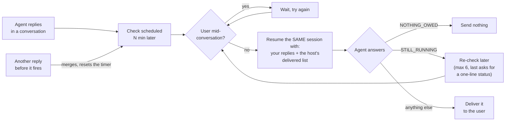

# nothing-owed

**A timer on every agent reply. When it fires, the agent checks its own conversation against what really reached the user, and delivers whatever it still owes.**

> **TIRED OF AI AGENTS PROMISING THINGS THEY NEVER DELIVER?**
>
> Your agent swore it would send the report "as soon as it lands"... and it never landed?
> Your assistant said "I'll get back to you" and then simply *ceased to exist between turns*?
>
> **WELL, NOT ANYMORE.**

[](./LICENSE)
[](./package.json)
[](https://github.com/muziksociety/nothing-owed/actions/workflows/ci.yml)




## The problem

*(Dramatic black-and-white footage of a person staring at a chat window.)*

LLM agents promise follow-ups they cannot keep, because nothing runs between turns. Claude, GPT, whoever: between your messages, your agent is not "working on it". It is not anything. It is a file on a disk.

Here is how it goes. A user sends a video link. The agent answers: *"Got it, I'll send you the summary when it's done."* It starts the work. The summary does get written, in a background turn whose output never went anywhere. The user waits. Nothing arrives. Ask the agent later and it will often say it already sent it, because the summary is right there in its context.

The agent did not lie. It just has no clock, and it cannot tell "I wrote it" from "the user received it".

### Real* testimonials

> "My agent said 'downloading now, full summary coming.' I'm still waiting."
> **A Real Human**, three weeks later

> "It told me it would 'circle back.' It has not circled. It has not even lined."
> **A Project Manager**, slowly losing faith

> "I asked if it sent the file. It said yes. With confidence. With *bullet points.*"
> **Someone Who Checked Their Inbox**

<sub>*Invented. Any resemblance to your own agent is, sadly, extremely likely.</sub>

## The fix

**How it works: we exploit the one thing your agent is truly reliable at. Forgetting.**

- After **every** reply the agent sends, schedule one check for that conversation, 10 minutes later.
- A newer reply in the same conversation merges into the pending check: one check per quiet period.
- When the check fires, resume the **same** session and show the agent two lists: what it replied since the last check, and what the host **actually delivered**, from the host's own send log.
- The agent answers `NOTHING_OWED`, `STILL_RUNNING`, or the thing it owes, which goes to the user.

No promise detection, no phrase lists, no extractor model. It relies on the agent forgetting, and on the agent being good at judging its own conversation once it is shown the truth about delivery.

### But wait, there's more!

- **Zero dependencies.** Nothing to install but the thing itself.
- **Survives restarts.** Pending checks live in a file. Your agent's promises outlive your process.
- **Polite.** If the user is mid-conversation, the check waits its turn.
- **Knows when to stop.** Capped rechecks, and a check's own reply never starts another check. No infinite nagging loops.

**Operators are standing by.** *(They are a `setTimeout`.)*

<sub>Side effects may include: receiving the things you were promised. Consult your send log before use.</sub>

## Quick start

```sh
npm install nothing-owed
```

```js
import { createNothingOwed, createFileStore } from 'nothing-owed';

const owed = createNothingOwed({
  store: createFileStore('./data/pending-checks.json'),
  runTurn: (conversationId, prompt) => agent.resume(conversationId, prompt), // same session
  deliver: (conversationId, text) => chat.send(conversationId, text),
  isUserBusy: (conversationId) => turnsInFlight.has(conversationId),
});
await owed.start();

// wherever your host sends a message to the user:
owed.noteDelivered('chat-42', text);   // it really reached the user
owed.noteReply('chat-42', text);       // the agent replied: start (or extend) the timer
```

Try it without an API key:

```sh
node examples/simulate.mjs
```

```text
[+   0 ms] user    "Can you summarize this video? https://example.com/v/123"
[+   1 ms] host    -> user: "Got it. I'll send the summary when it's done."
[+   2 ms] timer   check scheduled for chat-42 in 300 ms
[+ 102 ms] agent   wrote the summary in a background turn... but nothing sent it (dropped)
[+ 305 ms] check   fires for chat-42; the agent audits its conversation
[+ 306 ms] host    -> user: "SUMMARY: three points: setup, demo, pricing. Verdict: worth a watch."
[+ 306 ms] check   owed item delivered
[+ 454 ms] user    "Thanks!"
[+ 454 ms] host    -> user: "You are welcome."
[+ 454 ms] timer   check scheduled for chat-42 in 300 ms
[+ 756 ms] check   fires for chat-42; the agent audits its conversation
[+ 756 ms] check   NOTHING_OWED: nothing sent
```

## How it works

1. **`noteReply(conversationId, text)`** after each reply the agent sends. If that conversation has no pending check, one is created, due `delayMs` later. If it has one, the reply is appended and the due time moves.
2. **`noteDelivered(conversationId, text)`** whenever your transport confirms a message reached the user (or pass your own `getDelivered`). This is the ground truth. Record it at the transport layer, after the send succeeded, never from what the model says it sent.
3. **When the check is due**, it first yields if `isUserBusy(conversationId)` is true. Then it calls `runTurn(conversationId, prompt)`, which must resume the same session. The prompt lists the agent's replies and the delivered messages since just before the first of them, and says:

   > Only what is in this delivered list reached the user. Anything you wrote that is not in it, they never saw.

4. **The answer is parsed** (`parseOutcome`), and acted on (see below). The check's own reply never schedules a new check, and neither do replies you mark `{ kind: 'report' }` or `{ kind: 'system' }`.
5. **Pending checks persist** in the store. After a restart, `start()` reloads them; a check that was running when the process stopped runs again.

The full prompt is in [`src/outcome.js`](./src/outcome.js). Override it with `buildPrompt` if you need to.

## Outcomes

| The agent answers | What happens |
|---|---|
| `NOTHING_OWED` | Nothing is sent. The check ends. |
| `STILL_RUNNING` | The only debt is background work that will report on its own. Nothing is sent; the check comes back `delayMs` later. After `maxRechecks` (6) rechecks, the last check asks for a one-line status instead. |
| anything else | It is the owed content. It goes to the user through `deliver()`. |
| empty, `...`, a `failTexts` entry, or an error | Silent. The failure is reported through `onEvent`, never to the user. |

Parsing is forgiving: `` `NOTHING_OWED` ``, `**NOTHING_OWED**`, `nothing_owed.` all count. `NOTHING_OWED, but...` does not; it is delivered.

## Configuration

| Option | Default | Meaning |
|---|---|---|
| `runTurn(id, prompt, ctx)` | required | Resume the same conversation's session with `prompt`. Return the reply text, or `{ text, usage, costUsd }`. |
| `deliver(id, text)` | required | Send a check reply to the user. |
| `getDelivered(id, sinceMs)` | built-in log | Your send log: `[{ at, text }]` for that conversation since `sinceMs`. |
| `isUserBusy(id)` | none | Return `true` while the user is mid-conversation; the check waits `busyRetryMs` and tries again. |
| `store` | memory | `createFileStore(path)`, `createMemoryStore()`, or any `{ load(), save(records) }`. |
| `delayMs` | `600000` (10 min) | Quiet time after the last reply before the check fires. |
| `maxRechecks` | `6` | `STILL_RUNNING` rechecks before the final status check. |
| `busyRetryMs` | `60000` | Retry delay while the user is busy. |
| `deliveredLookbackMs` | `600000` | The delivered window opens this long before the first merged reply (a streamed reply can land before its turn ends). |
| `maxReplies` | `12` | A merged check keeps the newest N replies. |
| `maxTextLength` | `300` | Texts in the prompt are clipped to this length. |
| `userLabel` | `"the user"` | How the prompt names the user. |
| `failTexts` | `[]` | Canned error notices your runtime returns in place of a reply; treated as failures. |
| `onEvent(event)` | none | `scheduled`, `merged`, `check_started`, `yielded`, `nothing_owed`, `still_running`, `delivered`, `failed`, `usage`, `error`, `started`, `stopped`. |
| `onUsage({ id, usage, costUsd })` | none | Fires when `runTurn` returns usage or cost. Use it to track what checks cost. |
| `buildPrompt`, `parseOutcome` | built-in | Replace the prompt or the parser. |
| `deliveredLog` | memory | `createDeliveredLog({ path })` to persist the built-in log. |
| `now`, `setTimer`, `clearTimer` | real clock | Inject for tests. |

Methods: `noteReply(id, text, { kind? })`, `noteDelivered(id, text, at | { at, id })`, `start()`, `stop()`, `tick()` (run due checks now), `idle()` (wait for running checks), `pending()`.

Also exported: `buildPrompt()`, `parseOutcome()`, `createFileStore()`, `createMemoryStore()`, `createDeliveredLog()`, `NOTHING_OWED`, `STILL_RUNNING`. Types are in [`index.d.ts`](./index.d.ts).

## Adapters

| Example | What it shows |
|---|---|
| [`examples/simulate.mjs`](./examples/simulate.mjs) | A dropped promise caught by a fake model. No API key. |
| [`examples/telegram-grammy`](./examples/telegram-grammy) | A grammY API transformer that logs every successful Bot API send (and edits of streamed messages) as delivered. One conversation per chat and forum topic. |
| [`examples/claude-agent-sdk`](./examples/claude-agent-sdk) | The check turn resumes the conversation's session by id with `query({ options: { resume } })`. |
| [`examples/claude-code-cli`](./examples/claude-code-cli) | The check turn is `claude -p --resume <session id> --output-format json`, with per-check cost from the token counts. |

## Results

From a production chat assistant, measured before this package was extracted:

| Test | Result |
|---|---|
| Offline replay on real past conversations, tools sealed off: owed cases caught | **4 / 4** (one of them as `STILL_RUNNING`) |
| Same replay: false alarms on conversations where nothing was owed | **0 / 5** |
| Earlier prompt version, without the delivered list | 3 / 4 caught |
| Cost per check in the replay, cold cache | about **$0.53** |
| First live check, cold cache | **$0.36** |
| Live check, warm cache | expected to be a few cents (being measured) |

The delivered list is what closed the gap from 3/4 to 4/4: without it, the agent sees a summary in its own context and assumes the user got it.

Cost depends on your model and conversation length; the check turn re-reads the session, so prompt caching matters most. Report `usage` from `runTurn` and track it with `onUsage`.

## How it compares

- **Commitment tracking (extractor model plus a ledger).** A second model reads each reply, extracts promises into a ledger, and a scheduler chases open items. It works, but it adds a model call per reply, an extraction schema, and a classifier that can miss promises phrased in a way it did not expect. nothing-owed has no extractor: every reply gets the same blind timer, and the agent that made the promise judges it, with its full context.
- **Durable workflow engines (Temporal, Inngest, and similar).** Great when the follow-up is a known step in code: they guarantee that step runs. They do not know about promises the model improvised in free text. You can run nothing-owed on top of one, using it as the timer and store.
- **Why a blind timer plus self-audit is simpler.** One timer per conversation, one extra turn per quiet period, no promise detection. The hard part, "is anything still owed?", goes to the party best placed to answer it, and the delivered list gives it the one fact it cannot know on its own.

## FAQ

**What does it cost?** One extra turn per conversation per quiet period, not per message. A busy conversation still costs one check once it goes quiet. Most checks answer `NOTHING_OWED` with a few output tokens; the input is the resumed session, so a warm prompt cache makes checks cheap. Tune `delayMs` to trade latency for fewer checks.

**What about false alarms?** In the replay above, 0 of 5 conversations where nothing was owed produced a message. The prompt asks for the exact token `NOTHING_OWED`; anything else is delivered, so a model that rambles will send a message. If you see that, add an example to your system prompt or tighten `buildPrompt`.

**Why not detect promises with phrases?** Promises come in every language and phrasing ("I'll ping you", "te aviso", "will report back", "give me ten minutes"), and many debts are implied rather than promised. A phrase list misses those and fires on harmless ones. The agent already knows what it meant.

**Can the check loop forever?** No. A check reply never schedules a new check, `STILL_RUNNING` is capped at `maxRechecks`, and the last check asks for a one-line status instead.

**What if the user is talking to the agent when the check fires?** Pass `isUserBusy`. The check waits and retries; your user's turns always go first. A reply sent meanwhile merges into the check.

**Does the agent need tools during the check?** Not to judge. If it owes a result it can only produce with tools, let `runTurn` allow them, but keep the turn short: the prompt tells it not to sleep or poll.

## License

[MIT](./LICENSE)

---

<sub>Not affiliated with Anthropic, OpenAI or any agent that owes you something.</sub>
